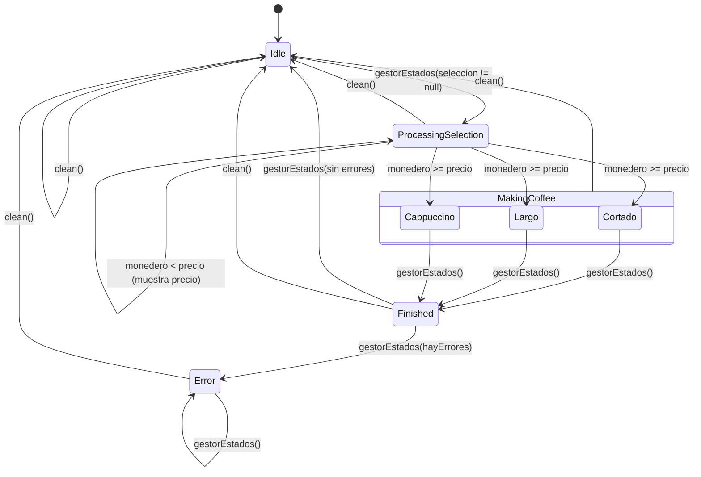

# Máquina de estados

| Diagrama | Estado en el código |
|---|---|
| E0 - ERROR | `Error(message, origen)` |
| E1 - Esperando | `Idle(timestamp)` |
| E2 - Procesando selección | `ProcessingSelection(seleccion)` |
| Elaborando (*) | `MakingCoffee` → `Cortado`, `Largo`, `Cappuccino` |
| E3 - Terminado | `Finished(bebida)` |

## Diagrama de estados

