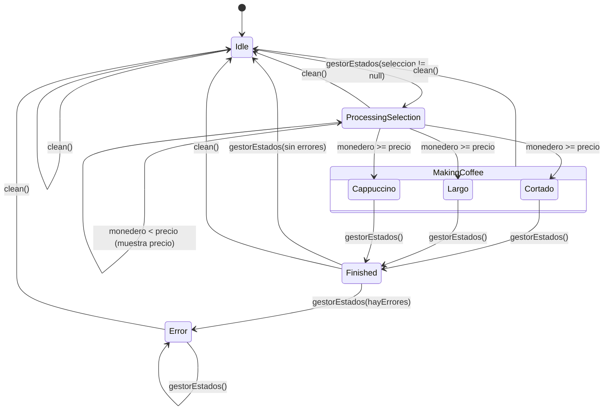

# ☕ Práctica: Máquina de Café (estados)

Simulación en Kotlin del diagrama de estados de una cafetera, usando una `sealed class`,
`object`, `data class`, herencia (`open` / `override`) y documentación KDoc.

## 1. Esquema en papel

Primero se dibujó a mano el diagrama con los estados y las transiciones:


| Esquema | Estado en el código |
|---|---|
| E0 - ERROR (por estado) | `Error(message, origen)` |
| E1 - Esperando | `Idle` |
| E2 - Procesando selección (comprueba saldo; si no basta, muestra el precio) | `ProcessingSelection(seleccion)` |
| Elaborando (cortado\*, largo\*, cappuccino\*) | `MakingCoffee` → `Cortado`, `Largo`, `Cappuccino` |
| E3 - Terminado (comprueba que no haya errores) | `Finished(bebida, taza)` |

Son **5 estados**, el máximo que pide la práctica.

## 2. Diagrama en Mermaid



## 3. Estructura del código

| Fichero | Contenido |
|---|---|
| `CofeeMachineState.kt` | `sealed class CoffeeMachineState`, `enum Bebida` y la `data class StateChange` (historial) |
| `CofeeMachine.kt` | `object CoffeeMachine` (singleton): `gestorEstados()`, `clean()`, `printHistory()` |
| `Taza.kt` | `open class Taza` y sus subclases `TazaEspresso`, `TazaGrande` y `TazaCappuccino` |
| `Electrodomestico.kt` | `open class Electrodomestico`, clase base de la que hereda la cafetera |
| `Main.kt` | Programa de prueba que recorre todo el esquema |

### `object` o `data class`

| Estado | Tipo | ¿Por qué? |
|---|---|---|
| `Idle(timestamp)` | `data class` | Guarda desde cuándo está esperando la máquina. |
| `Cortado`, `Largo`, `Cappuccino` | `object` | No necesitan datos propios (precio y taza están en `Bebida`). |
| `ProcessingSelection(seleccion)` | `data class` | **Estado con datos que no estaba en el ejemplo:** guarda la bebida elegida. |
| `Finished(bebida, taza)` | `data class` | Guarda qué se sirvió y en qué taza. |
| `Error(message, origen)` | `data class` | Guarda el motivo y el estado donde ocurrió el fallo (E0 «por estado»). |
| `StateChange(from, to, timestamp)` | `data class` | Registro de cada transición → **historial de estados**. |

## 4. Conceptos aplicados

- **Clase sellada**: el `when` de `gestorEstados()` no lleva `else`; el compilador comprueba que se
  cubren todos los estados. Si se añade uno nuevo y no se trata, **no compila**. `MakingCoffee` es
  a su vez una clase sellada con un estado por bebida.
- **Herencia**: `Taza` es `open` y cada taza hace `override` de `descripcion()`.
  `Finished` guarda la taza de la bebida. `CoffeeMachine` (un `object`) hereda de `Electrodomestico`
  y redefine `log()`.
- **Visibilidad**: `currentState` es `private`; desde fuera solo se lee con `state`. El historial
  se expone como `List` de solo lectura. `changeState()` es el único sitio donde cambia el estado.
- **Reseteo**: al terminar (`Finished` sin errores) la máquina vuelve a `Idle`, y `clean()` la resetea
  desde cualquier estado, incluido `Error`.

## 5. Cómo ejecutarlo

1. Abre el proyecto en IntelliJ IDEA (el repositorio solo versiona `src/` y la configuración de Gradle/`.idea` se genera en local).
2. Ejecuta `main()` en `Main.kt`.

## 6. Salida de ejemplo (resumida)

```
--- Cappuccino con saldo insuficiente ---
[Cafetera] ☕ Estado actual: ProcessingSelection(seleccion=CAPPUCCINO)
[Cafetera] ☕ Saldo insuficiente. CAPPUCCINO cuesta 2.

--- Ahora con saldo suficiente ---
[Cafetera] ☕ Estado actual: Cappuccino
[Cafetera] ☕ Estado actual: Finished(bebida=CAPPUCCINO, taza=Taza de cappuccino de 250 ml (...))
[Cafetera] ☕ Ya tienes tu CAPPUCCINO en Taza de cappuccino de 250 ml (...). ¡Que aproveche!
```
