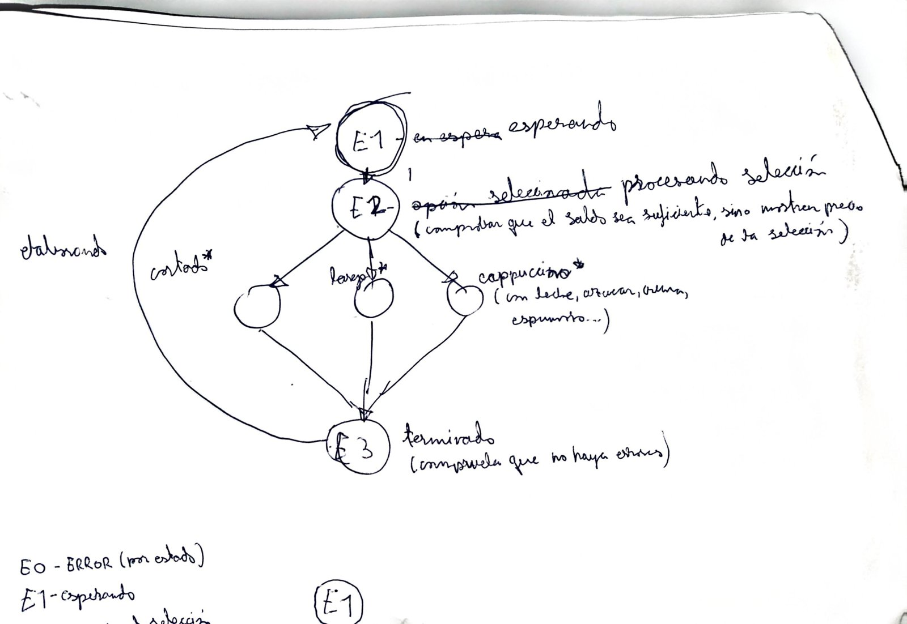
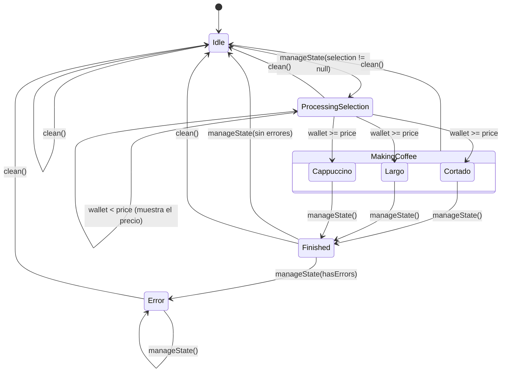

# ☕ Práctica: Máquina de Café (estados)

Simulación en Kotlin del diagrama de estados de una cafetera, usando una `sealed class`,
`object`, `data class`, herencia (`open` / `override`) y documentación KDoc.

## 1. Esquema en papel

Primero se dibujó a mano el diagrama con los estados y las transiciones:



| Esquema | Estado en el código |
|---|---|
| E0 - ERROR (por estado) | `Error(message, origin)` |
| E1 - Esperando | `Idle` |
| E2 - Procesando selección (comprueba saldo; si no basta, muestra el precio) | `ProcessingSelection(selection)` |
| Elaborando (cortado\*, largo\*, cappuccino\*) | `MakingCoffee` → `Cortado`, `Largo`, `Cappuccino` |
| E3 - Terminado (comprueba que no haya errores) | `Finished(drink, cup)` |

Son **5 estados**, el máximo que pide la práctica.

## 2. Diagrama en Mermaid



## 3. Estructura del código

| Fichero | Contenido |
|---|---|
| `CoffeeMachineState.kt` | `sealed class CoffeeMachineState`, `enum Drink` y la `data class StateChange` (historial) |
| `CoffeeMachine.kt` | `object CoffeeMachine` (singleton): `manageState()`, `clean()`, `printHistory()` |
| `Cup.kt` | `open class Cup` y sus subclases `EspressoCup`, `LargeMug` y `CappuccinoCup` |
| `Appliance.kt` | `open class Appliance`, clase base de la que hereda la cafetera |
| `Main.kt` | Programa de prueba que recorre todo el esquema |

### `object` o `data class`

| Estado | Tipo | ¿Por qué? |
|---|---|---|
| `Idle` | `object` | No necesita datos → una única instancia. |
| `Cortado`, `Largo`, `Cappuccino` | `object` | No necesitan datos propios (precio y taza están en `Drink`). |
| `ProcessingSelection(selection)` | `data class` | **Estado con datos que no estaba en el ejemplo:** guarda la bebida elegida. |
| `Finished(drink, cup)` | `data class` | Guarda qué se sirvió y en qué taza. |
| `Error(message, origin)` | `data class` | Guarda el motivo y el estado donde ocurrió el fallo (E0 «por estado»). |
| `StateChange(from, to, timestamp)` | `data class` | Registro de cada transición → **historial de estados**. |

## 4. Conceptos aplicados

- **Clase sellada**: el `when` de `manageState()` no lleva `else`; el compilador comprueba que se
  cubren todos los estados. Si se añade uno nuevo y no se trata, **no compila**. `MakingCoffee` es
  a su vez una clase sellada con un estado por bebida.
- **Herencia**: `Cup` es `open` y cada taza hace `override` de `description()`.
  `Finished` guarda la taza de la bebida. `CoffeeMachine` (un `object`) hereda de `Appliance`
  y redefine `log()`.
- **Visibilidad**: `currentState` es `private`; desde fuera solo se lee con `state`. El historial
  se expone como `List` de solo lectura. `changeState()` es el único sitio donde cambia el estado.
- **Reseteo**: al terminar (`Finished` sin errores) la máquina vuelve a `Idle`, y `clean()` la resetea
  desde cualquier estado, incluido `Error`.

## 5. Cómo ejecutarlo

1. Abre la carpeta en IntelliJ IDEA (se importa como proyecto Gradle).
2. Ejecuta `main()` en `Main.kt`, o desde terminal con `gradle run`.

## 6. Salida de ejemplo (resumida)

```
--- Cappuccino con saldo insuficiente ---
[Cafetera] ☕ Nuevo estado: ProcessingSelection(selection=CAPPUCCINO)
[Cafetera] ☕ Saldo insuficiente. CAPPUCCINO cuesta 2.

--- Ahora con saldo suficiente ---
[Cafetera] ☕ Nuevo estado: Cappuccino
[Cafetera] ☕ Nuevo estado: Finished(drink=CAPPUCCINO, cup=Taza de cappuccino de 250 ml (...))
[Cafetera] ☕ Ya tienes tu CAPPUCCINO en Taza de cappuccino de 250 ml (...). ¡Que aproveche!
```
