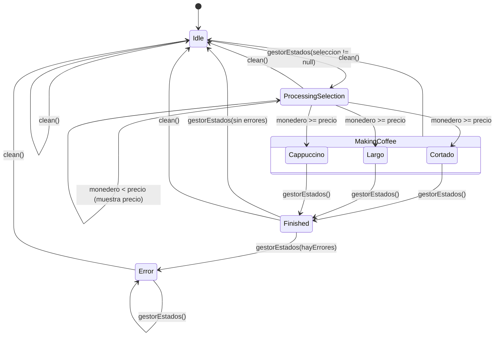

# ☕ Práctica: Máquina de Café (estados)

Simulación en Kotlin del diagrama de estados de una cafetera, usando una `sealed class`,
`object`, `data class`, herencia (`open` / `override`) y documentación KDoc.

## 1. Esquema en papel

Primero se dibujó a mano el diagrama con los estados y las transiciones:

| Esquema | Estado en el código |
|---|---|
| E0 - ERROR (por estado) | `Error(message, origen)` |
| E1 - Esperando | `Idle` |
| E2 - Procesando selección (comprueba saldo; si no basta, muestra el precio) | `ProcessingSelection(seleccion)` |
| Elaborando (cortado\*, largo\*, cappuccino\*) | `MakingCoffee` → `Cortado`, `Largo`, `Cappuccino` |
| E3 - Terminado (comprueba que no haya errores) | `Finished(bebida, taza)` |

Son **5 estados**, el máximo que pide la práctica.

## 2. Diagrama en Mermaid

## 3. Código

| Fichero | Contenido |
|---|---|
| `CofeeMachineState.kt` | `sealed class CoffeeMachineState` y `enum Bebida` |
| `CofeeMachine.kt` | `object CoffeeMachine` (singleton) con `gestorEstados()` y `clean()` |
| `Taza.kt` | `open class Taza` y sus subclases `TazaPequena` y `TazaGrande` |
| `Main.kt` | Programa de prueba |

### `object` o `data class`

| Estado | Tipo | ¿Por qué? |
|---|---|---|
| `Idle` | `object` | No necesita datos → una única instancia. |
| `Cortado`, `Largo`, `Cappuccino` | `object` | No necesitan datos propios. |
| `ProcessingSelection(seleccion)` | `data class` | **Estado nuevo con datos:** guarda la bebida elegida. |
| `Finished(bebida, taza)` | `data class` | Guarda qué se sirvió y en qué taza. |
| `Error(message, origen)` | `data class` | Guarda el motivo y el estado donde ocurrió. |

## 4. Conceptos aplicados

- **Clase sellada**: el `when` de `gestorEstados()` no lleva `else`; el compilador comprueba que se
  cubren todos los estados.
- **Herencia**: `Taza` es `open`; `TazaPequena` y `TazaGrande` heredan y hacen `override` de `descripcion()`.
- **Reseteo**: al terminar sin errores la máquina vuelve a `Idle`, y `clean()` la resetea desde cualquier estado.

## 5. Cómo ejecutarlo

Abre el proyecto en IntelliJ IDEA y ejecuta `main()` en `Main.kt`.
